[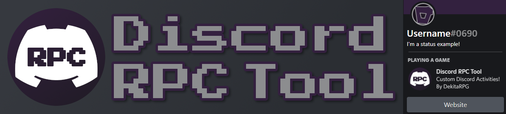](https://dekitarpg.com/rpc)

<div align="center" class="d-flex mb-2">
<div align="center" class="mx-auto d-block">
    <a href="https://github.com/Dekita/Discord-RPC-Tool/releases/latest" target="new"></a>
    <a class="mx-2" href="https://discord.gg/WyTdramBkm" target="new"></a>
    <a href="https://github.com/Dekita/Discord-RPC-Tool/stargazers" target="new"></a>
</div>
</div>

### Table of Contents
- [How to install](#how-to-install) 
- [What is Discord RPC Tool](#what-is-discord-rpc-tool) 
- [RPC Tool Features](#rpc-tool-features) 
- [Latest Changelog](#changelog-v100) 
- [Launching your first activity](#launching-your-first-activity) 
- [Main Activity Customization](#main-activity-customization) 
- [Activity Image Customization](#activity-image-customization) 
- [Activity Button Customization](#activity-button-customization) 
- [Themes](#themes)
- [Backing Up Your Activities](#backing-up-your-activities)
- [Advanced Activity Text](#advanced-activity-text) 
- [Privacy](#privacy)
- [Important Notes](#important-notes) 

<hr class="mt-1">

### What is Discord RPC Tool
RPC Tool is a simple application that allows you to easily communicate with the Discord `Rich Presence Client`. RPC is a service that the Discord application installed on your machine enables. The RPC allows other applications, like this one, to communicate with the running Discord app. RPC Tool uses this feature to set the user currently logged into Discord's `Now Playing` activity.


<hr class="mt-1">

### RPC Tool Features
- Painless Installation and Automatic Updates
- Modern UI Inspired by Discord
- Live Profile Preview
- Multiple Applications, each with Unlimited Activities
- Activity Types: Playing, Listening, Watching or Competing
- Changes Saved Automatically
- Export and Import Application Data
- Automatic Reconnect if Discord Restarts
- System Notifications
- Multi Platform Support (win+linux)
- 10 Themes, plus your own with the Color Customizer
- API Polling for Advanced Activities
- Optional Minimize to System Tray
- Optional Auto Start Activity on Launch
- Optional Auto Minimize App on Launch
- Optional Auto Launch App on System Boot
- Optional Activity Elapsed Time
- Auto Detect App Name, Icon, Description, etc
- Replace Activity Text with your;
time, date, region, timezone, playtime, and more...
<hr class="mt-1">

### Changelog (v1.0.0)
Version 1.0 also includes the changes from v0.0.96, which was never released.

###### New Look
- Redesigned interface inspired by Discord, with a frameless window and custom titlebar
- Activity editor grouped into Text, Images, Buttons and Advanced sections
- Toggle switches replace checkboxes, switched off images and buttons fade out
- Big `Launch activity` button that shows how long you have been live
- Status pill next to the activity name: Ready, Connecting, Live on Discord
- Preview now looks like a current Discord profile, and updates as you type
- Image picker shows thumbnails of your application's art assets
- App icons show their name on hover, and a green dot while live
- Welcome guide on first launch, reopen it with the info button
- New toast notifications that stack in the corner and close themselves
- Smoother animations throughout

###### Applications and Activities
- Activity type: show Listening to, Watching or Competing in, instead of Playing
- Applications and activities are now split, each application has unlimited activities
- Activity menu (cog icon) to rename, duplicate or delete activities
- Asks before switching activity while one is live
- Export and import application data as a JSON file
- Changes are saved automatically (save button removed)
- Data now saved to a file in your app data folder, older data is moved over automatically
- A backup of your data is kept, and used automatically if the saved file is ever damaged
- Image keys now sorted alphabetically

###### Themes
- Pick themes from color tiles in Settings
- Themes renamed to describe how they look, your choice is carried over
- Every theme reworked so text is easy to read, burnt-orange and nature4 removed
- New color customizer: changes show on the app straight away, with a readability check
- Custom themes now save every color, so they look the same whichever theme you start from
- The guide window uses your theme too, and changes with it

###### Connection and Updates
- Reconnects automatically if Discord restarts or the connection drops
- Asks before restarting to install an update, otherwise installs when the app closes

###### Fixes
- Fixed the auto updater not reporting its progress
- Fixed settings that are off or zero being reset to their defaults
- Fixed the RPC update frequency setting being ignored
- Fixed reloading the main window showing the help page
- Fixed the theme selector dropdown
- Fixed `{playtime}` leaving out the largest unit, eg: the day in `1 day, 1 hour`
- Support server link updated

###### Under the Hood
- Updated to Electron 45, with the renderer sandboxed and isolated for security
- Discord connection moved to the main process
- Renderer switched to ES style modules
- Icons bundled with the app, so they show without an internet connection
- Error log moved to the app's logs folder, and kept to a sensible size
- Automated tests added for saving data, the activity lists and input checks
- New [Privacy](#privacy) section explaining what the usage counter sends
<hr class="mt-1">

### Changelog (v0.0.95)
- Bugfix for app id not properly registering
- Activities can now be moved position using drag+drop
- Theme menu moved changed from window to modal
- New theme randomization types powered by colormind.io
- Various theme customization gui improvements
- Added replacers for time/date/locale/timezone/playtime
- Fixed support server links and added to help guide
- Separated code chunks for future refactor
- Added api polling for user counts
- Scrollbar styling improvements
- New 'toast' style alerts
<hr class="mt-1">

### Changelog (v0.0.94)
- Bugfix for application images not being reloaded
- Bugfix for additional activities not refreshing images
- New button to refresh application details (at app id)
- New button to use application icon as activity image in app
- New buttons to pull details and summary from application data
<hr class="mt-1">

### Changelog (v0.0.93)
- Added save as custom theme option to theme creator
- Update notifications altered
- Added 10 new theme styles 
<hr class="mt-1">

### Changelog (v0.0.92)
- Automatic Updater - make sure your always on the latest version
- New theme creator - make the app look how you want it
- System Notifications - if your activity stops, now you know
- App now hosted on github, no more gumroad.  
<hr class="mt-1">

### Changelog (v0.0.91)
- Load application name and assets from app id
- Image key input area changed to asset dropdown
- Added theme options based on discord (x2 dark, x2 light)
- Altered gui elements to be more in line with discord.
- Removed activity name (was only used in the RPC Tool app)
- Moved API URL and Frequency settings into advanced section
- Updated preview display to use image assets
<hr class="mt-1">


### How to install 
<a href="https://github.com/Dekita/Discord-RPC-Tool/releases/latest" target="new">
Click Here To Download!!
</a>

Once downloaded extract and then run the installer.

Discord RPC Tool is now installed on your pc.

<hr class="mt-1">

### How to install (development)
| :exclamation: Node.js (v22 or newer) and Yarn are required for development |
|---|

```
git clone https://github.com/Dekita/Discord-RPC-Tool.git
```
```
cd Discord-RPC-Tool
```
```
yarn install
```
```
yarn start
```

To build the installers yourself, the files are written to the `build` folder:

Windows installer and Linux AppImage
```
yarn build
```
Windows installer only (run on Windows)
```
yarn build:windows
```
Linux AppImage only (needs [Docker](https://www.docker.com/) installed and running)
```
yarn build:linux
```

| :exclamation: The Linux AppImage cannot be built directly on Windows, so `yarn build:linux` builds it inside a Docker container. On Linux you can also build it without Docker using `npx electron-builder --linux --publish never` |
|---|

<hr class="mt-1">

### Launching your first activity
The first time you open RPC Tool, a short welcome guide walks you through the three steps below. You can reopen it at any time with the info button in the top right.

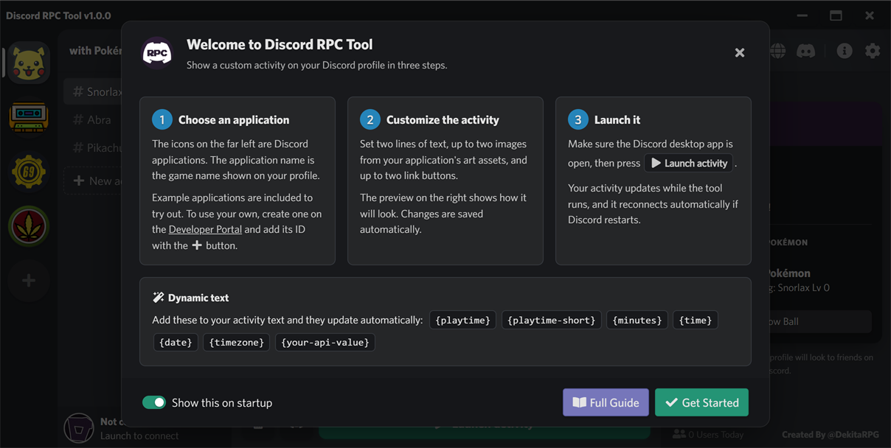

Once the application is installed and running on your machine, click on the `Discord` icon button next to `Launch activity`. This will open the discord developer portal. Once logged into the dev portal, create a new application and name it whatever you want. This is the name that will be shown for your activity.

While on the `General Information` tab, after naming your application, copy the `Application ID`. In RPC Tool, click the `+` button below the application icons on the left, paste the id, then click `Add application`.

Your changes are saved automatically. When you are ready, press `Launch activity`. After a second or so, your user profile card on Discord should now look similar to this:

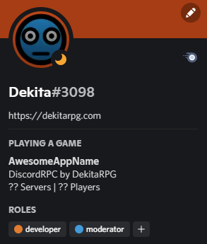

:exclamation: If the activity is not showing on your user profile card, make sure that you are not showing as invisible/offline, and that you have enabled `Activity Status` within the discord application's user settings. 

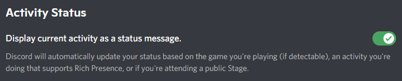

<hr class="mt-1">

### Main Activity Customization
Once you have launched your first activity, you are ready to begin properly customizing things. See the details below for each customizable option.
<hr class="mt-1">

###### Application ID
Each application icon on the left is one of your discord applications, added by its application id. You can get this from the Discord developer portal after you create your application. Each application can have as many activities as you like, listed next to the icons.
<hr class="mt-1">

###### Activities
Click the cog next to an activity to rename, duplicate, or delete it. Activities can be reordered by dragging them.
<hr class="mt-1">

###### Activity Text: Line 1 + 2
Text shown for the activity details and state (the first and second line of text shown below your app name on your profile card). The wand button next to each line fills it in from your application's description or summary on the developer portal. 
<hr class="mt-1">

### Activity Image Customization
Each activity can display upto two images, one large and one small. But before RPC Tool can display them properly, the image files must be uploaded onto the Discord developer portal's `Rich Presence => Art Assets` tab shown below. 
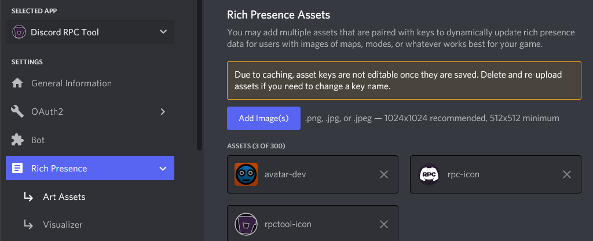

| :exclamation: Images may take a few minutes to show due to discords cache |
|---|

The image key that you enter on the developer portal should match the image key you select in the RPC Tool application. After adding new images on the dev portal, open the application menu (the arrows next to the application name) and click `Refresh from Discord` to reload the images. If they arent showing, wait a few minutes, and try again. If still not showing, refresh the developer portal to make sure discord has saved them properly.

Make sure to also switch your image on within the RPC Tool application. Hovering an image shows its hover text on Discord. 

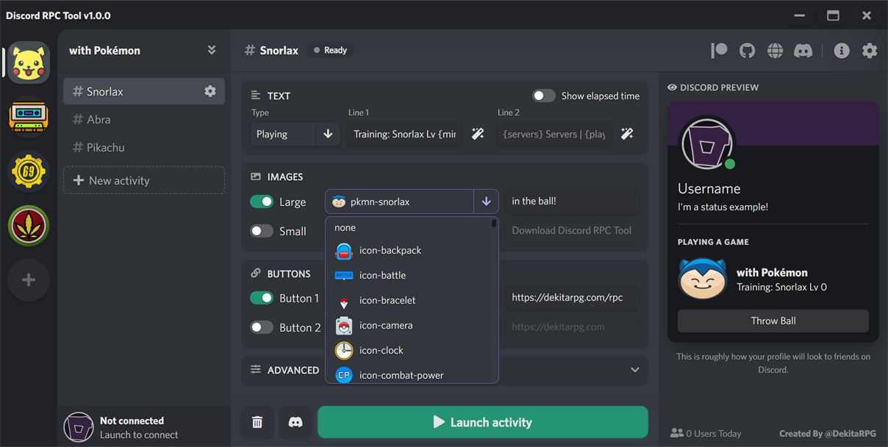

<hr class="mt-1">

### Activity Button Customization

| :exclamation: Your own activity buttons do not work for you, only other users! |
|---|

Each activity can also display upto two customizable buttons. Each enabled button must have a valid url and name or discord will not be able to process it correctly. Similar to activity images, buttons can easily be enabled and disabled.
<hr class="mt-1">

###### Custom API URL

| :exclamation: This feature is optional. Don't know what it does? You dont need it! |
|---|

Set this to a url that returns valid json data, then you can use the returned json object properties when setting your activity text. [[see here for details]](#advanced-activity-text)

<hr class="mt-1">

###### API Update Frequency [default=`300`]
The frequency in seconds for how often the application should poll the `Custom API URL` for its json data. The minimum is `60`.
<hr class="mt-1">

###### RPC Update Frequency [default=`15`]
The frequency in seconds for how often the application should send data to the Discord Rich Presence Client. The minimum is `15`.
<hr class="mt-1">

###### Activity Type
Changes how the activity is introduced on your profile: `Playing`, `Listening`, `Watching` or `Competing`. Choose it with the `Type` dropdown in the Text section.

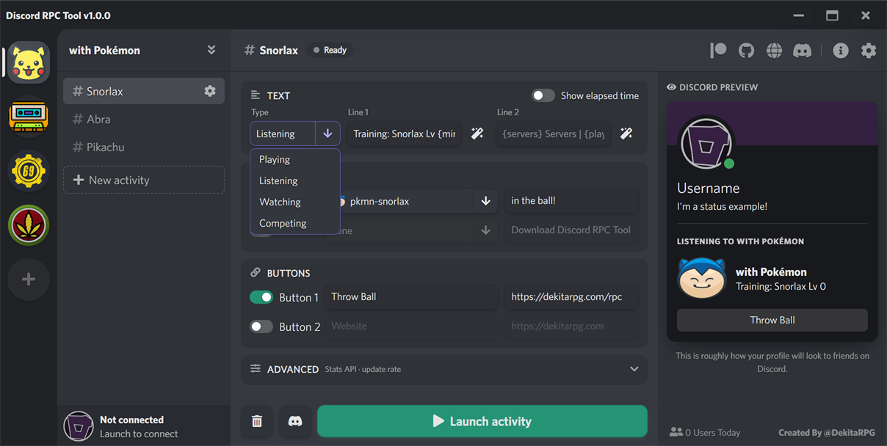
<hr class="mt-1">

###### Show Elapsed Time
Shows how long the current activity has been active, eg: `12:47 elapsed`. Turn it on with the switch at the top of the Text section.
<hr class="mt-1">

### Themes
Open `Settings` (the cog in the top right) and click a theme tile to switch themes.

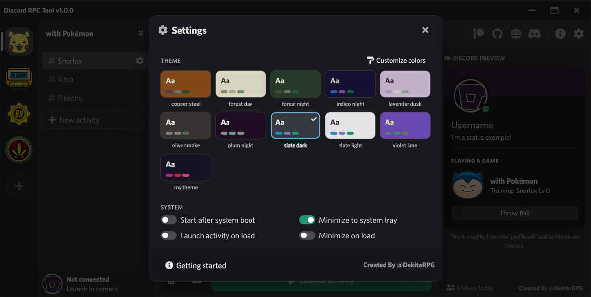

There are light and dark themes to choose from:

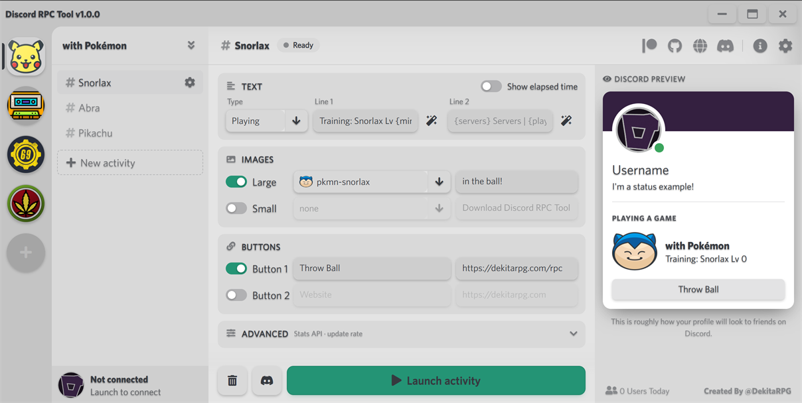
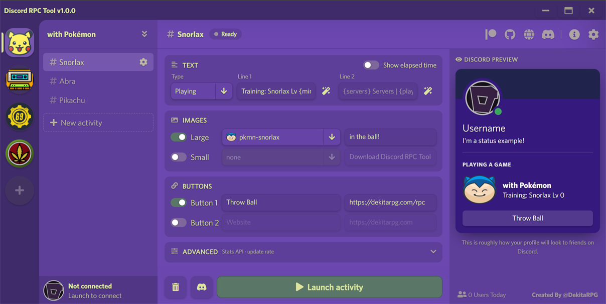

Click `Customize colors` to make your own: start from any theme, change its colors, and the app updates as you go. Press `Save as my theme` to keep it, or `Discard` to go back.

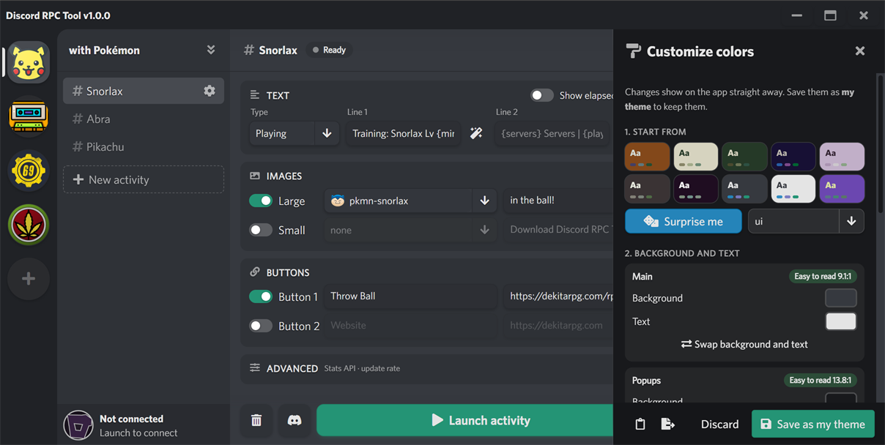
<hr class="mt-1">

### Backing Up Your Activities
Your applications and activities are saved automatically. To back one up or share it, open the application menu (the arrows next to the application name) and click `Export App Data`. Use `Import App Data` to load it again.
<hr class="mt-1">

### Advanced Activity Text

| :exclamation: Advanced Feature ~ Also the reason RPC Tool was created! |
|---|

If you have [[Custom API URL]](#custom-api-url) set to some endpoint that returns a valid json object, then you are able to use the properties of the returned object to replace parts of your activity text. For example, lets say your api url returns the following json object:
```json
{"players": 99, "servers": 3}
```
You can use these returned properties (`players` and `servers`) within your activity text by wrapping the property name in curly braces `{}`. 

Assuming the example json above, along with the following activity text: 
`{servers} Servers | {players} Players` 

Then the resulting text shown for the activity would be: 
`3 Servers | 99 Players` 

Additionally, there are a number of default replacers that you can use, without any api url, that will use app/system information. See below for more details;
`{date}` - formatted date
`{date-tz}` - formatted date with timezone
`{time}` - formatted time
`{time-tz}` - formatted time with timezone
`{region}` - your estimated region
`{timezone}` - your estimated timezone
`{playtime}` - logical playtime text
`{playtime-short}` - short playtime text
`{minutes}` - whole minutes since launch
`{minutes-float}` - minutes since launch, with decimals
`{rpc-website}` - rpc website url
`{rpc-support}` - rpc support server url
<hr class="mt-1">

### Privacy
The `Users Today` counter in the bottom corner is powered by a small ping to dekitarpg.com. While the installed app is open, it sends the following when it starts, and again every few minutes:
- a random ID created the first time the app runs (it is not linked to you or your Discord account)
- your timezone
- the app version

Nothing about your applications, activities or Discord account is sent. The app also contacts Discord (application names, icons and art assets), GitHub (update checks), colormind.io (theme randomizer), and any Stats API URL you add to an activity.
<hr class="mt-1">

### Important Notes
| :exclamation: Your own activity buttons do not work for you, only other users! |
|---|

| :exclamation: Your activity will not show if Discord's `Activity Status` setting is off, or you appear offline |
|---|

| :warning: Please report any bugs you find to the support server! |
|---|
